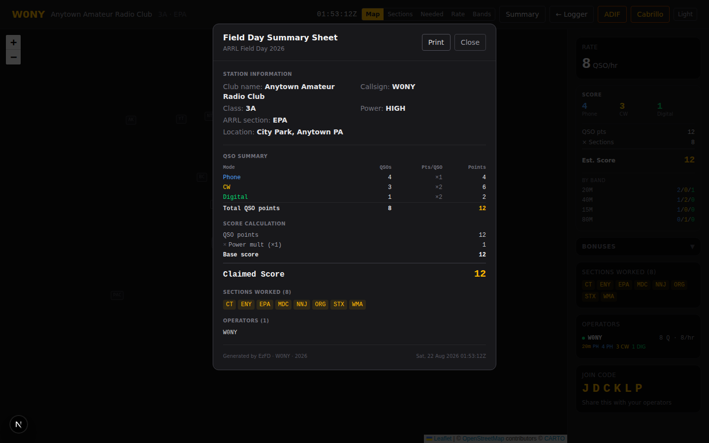

# Field Day and Winter Field Day

ARRL Field Day (June) and Winter Field Day (January) are the two contest event
types. They differ only in class letters and the Cabrillo contest name; the
rest of this page applies to both.

## Setting up

**Class** is a transmitter count plus a letter:

| Event | Letters |
|---|---|
| Field Day | `A` club portable · `B` home or one transmitter · `C` mobile · `D` home station · `E` emergency power · `F` EOC |
| Winter Field Day | `H` home · `O` outdoor · `I` indoor |

So `3A` is three transmitters, club portable. The entry form validates the
letter against the event type — a `3H` on a Field Day event is flagged.

**ARRL section** is your own section, sent as part of the exchange.

### Power category

On a Field Day event, **power category** is the highest output any transmitter
will use during the event (rule 7.2.5). It sets the score multiplier, and the
setup page only offers the categories your class may claim:

| Category | Output | Multiplier | Rule | Classes |
|---|---|---|---|---|
| High | Over 100 W, up to 500 W PEP | ×1 | 7.2.4 | A, B, C |
| Low | 100 W or less | ×2 | 7.2.3 | All |
| QRP battery | 5 W or less, on batteries, solar or another source that is not the mains or a generator | ×5 | 7.2.1 | A, B, C, E, F |
| QRP mains | 5 W or less, on the mains or a generator, or on batteries charged from either during the event | ×2 | 7.2.2 | All |

Classes D, E and F are limited to 100 W PEP (rule 4), so high power is not
offered to them. Class D runs on commercial power by definition (4.6), so its
QRP option is the ×2 one. Both QRP options are written to Cabrillo as `QRP`;
only the multiplier differs. A class C mobile on its vehicle battery or
alternator is on a motor-driven generator (4.5) and should pick QRP mains.

The category cannot be changed on the setup page after the event is created.
The admin console's **Edit event settings** changes it, and the
[pre-submission check](#before-you-submit) flags an event whose category its
class may not claim.

A Winter Field Day event has no power category to choose; see
[Winter Field Day](#winter-field-day).

## The exchange

Both contests use **class + section**. You send yours (taken from the event,
so operators never retype it) and log theirs.

The received section is validated against the app's section list and flagged
if unrecognised — again a warning, not a refusal, since the list can lag
changes to the official one.

## Scoring

```
score = QSO points × power multiplier + bonus points
```

| Component | Value |
|---|---|
| Phone QSO | 1 point |
| CW QSO | 2 points |
| Digital QSO | 2 points |
| High power (over 100 W) | ×1 |
| Low power (100 W or less) | ×2 |
| QRP, battery or solar (5 W or less) | ×5 |
| QRP, mains or generator (5 W or less) | ×2 |

**Sections do not multiply the score, and they are not a bonus either.** Rule
7.3 lists eighteen bonuses and none of them concerns sections. Working every
section is an operating goal the app helps you chase; it is worth no points.
Treating sections as a multiplier is the single most commonly mis-implemented
part of the Field Day formula, and getting it wrong inflates a score
enormously — a 60-section event would come out sixty times too high.

Duplicates score nothing and are excluded from exports.

## Bonus points

Tracked from the dashboard's **Bonus** panel. Changes save immediately and
appear on every connected screen.

| Bonus | Rule | Points |
|---|---|---|
| 100% emergency power | 7.3.1 | **100 per transmitter**, max 2,000 |
| Media publicity | 7.3.2 | 100 |
| Public location | 7.3.3 | 100 |
| Public information table | 7.3.4 | 100 |
| Message to Section Manager | 7.3.5 | 100 |
| Formal messages handled | 7.3.6 | 10 each, capped at 100 |
| Satellite QSO | 7.3.7 | 100 |
| Alternate power (5 QSOs) | 7.3.8 | 100 |
| W1AW bulletin copied | 7.3.9 | 100 |
| Educational activity | 7.3.10 | 100 |
| Elected official visit | 7.3.11 | 100 |
| Served agency rep visit | 7.3.12 | 100 |
| GOTA station QSOs | 7.3.13.1 | 5 each, no cap |
| GOTA coach | 7.3.13.2 | 100 |
| Entry via ARRL web app | 7.3.14 | 50 |
| Youth participants (≤18) | 7.3.15 | 20 each, capped at 100 |
| Social media promotion | 7.3.16 | 100 |
| Safety officer | 7.3.17 | 100 |
| Site responsibilities | 7.3.18 | 50 |

Values are transcribed from the official ARRL rules (Revised 4/2026), and each
row carries its rule number so you can check it against the source. Not every
bonus is available to every class — 7.3.1 excludes Class D, 7.3.17 is Class A
only, and so on. The app does not enforce class eligibility, so read the rule
before ticking a box.

**Emergency power is per transmitter, not a doubling.** A 3A entry claims 300
points, not "the whole score again" — the app read this wrong until the 2026
rules were checked line by line, which inflated claimed scores by thousands of
points. The panel shows the arithmetic (`+100 × 3 tx`) so the number is
visible rather than implied.

Bonuses are added **after** the power multiplier is applied, so a QRP entry's
bonuses are worth exactly the same as a high-power entry's. Rule 7.3.13.1 says
so explicitly for GOTA contacts, and it holds for all of them.

### Before you submit

Open **Summary** on the dashboard and the sheet opens with a short read of the
log: unrecognised sections, a station that sent two different exchanges, a
class or callsign that cannot be one, contacts on a band the entry cannot
score, any bonus claimed that rule 7.3 does not list for your class, and a
power category your class may not claim.

Two levels, and the difference matters:

| | Means |
|---|---|
| **Fix** | The log contradicts the claim. A Winter Field Day objective you have ticked that the log shows you did not meet — those multiply, so one wrong tick moves the whole score |
| **Check** | Worth your eye. It may be perfectly correct; the app cannot tell |

It does **not** check callsigns against a list of known stations. Field Day
exists to bring out operators who never enter contests, so the Super Check
Partial file simply does not contain many good Field Day callsigns — and it is
downloaded best-effort, so a field server with no internet has none of it at
all. Flagging every such contact would bury the findings that are real. The
panel names what it did not look at for the same reason.

Nothing here is refused or corrected for you. It is your entry.

### The GOTA station

Set a **GOTA callsign** when you create the event and operators can sign in at
the Get On The Air station: tick *I'm at the GOTA station* on the sign-in
screen. Their contacts are signed with that callsign, and the logger's header
shows it so there is no doubt what to say on the air.

A GOTA contact counts **twice**, which is rule 4.1.1.5:

> QSOs made by this station may be claimed for credit by its primary Field Day
> operation. In addition, bonus points may be earned by this station under
> rule 7.3.13.

So each one scores its normal QSO points *and* 5 bonus points. **There is no
cap** on the bonus and **no limit** on how many contacts a single GOTA operator
may make — both restrictions existed once and neither is in the current rules.
This app applied a 1,000-point cap for several releases that was never in them
at all.

Because the contacts are logged, the bonus is **counted rather than typed**:
the bonus panel shows the figure in green and the number field stands down. If
your club logs GOTA somewhere else, log none here and type the total instead —
the two are never added together.

Exported ADIF gives those contacts the GOTA callsign as `STATION_CALLSIGN`,
which is what LoTW signs by. Cabrillo keeps the entry callsign on every line:
the rules do not say what belongs there for a GOTA contact, so it was left as
it was rather than changed on a guess.

### Winter Field Day

Winter Field Day is run by the Winter Field Day Association, not the ARRL, and
scores by a different model — it has no bonus points and no power multiplier at
all:

```
score = total QSO points × (Objective Multiplier + 1)
```

Objectives are ticked in the same dashboard panel, which switches to an
**Objectives** list showing the OM each one contributes. See
[the rules reference](rules-reference.md#winter-field-day) for the full table.

There is no power category to set up. Every Winter Field Day station is limited
to 100 W PEP and there is no high-power category, so the setup page does not
ask. Running QRP (10 W or less on phone, 5 W or less on CW and digital) is an
objective worth OM 4: tick **Operate the event QRP** and the Cabrillo header
says `CATEGORY-POWER: QRP`; leave it unticked and it says `LOW`.

## Submitting

From the logger header or the dashboard:

**Cabrillo** (`CLUBCALL_FD2026.log`) is the ARRL submission format. Upload it
to the Field Day online entry form.

**ADIF** (`CLUBCALL_FD2026.adi`) is for LoTW, QRZ Logbook, or any log manager.
Contest QSOs carry `MY_ARRL_SECT`, `STX_STRING` (your class and section) and
`SRX_STRING` (theirs).

**Summary sheet** is a printable worksheet mirroring the ARRL entry form: QSO
totals by mode, the score calculation with the power multiplier shown as its
own line, active bonuses itemised, sections worked, and the operator list.



Both exports include only non-duplicate QSOs, in chronological order.

## Sections

The app ships a list of ARRL and RAC sections used for validation, the map and
the section grid. It contains **85** entries
— the 71 US sections plus the 14 current RAC sections, including Puerto Rico,
the Virgin Islands and the Ontario splits (`ONE`, `ONN`, `ONS`, `GH`). If you
work a section the app doesn't recognise you will get a warning and the QSO
will log normally — the exchange is stored as typed, and the dashboard lists
the unrecognised values so a typo can be spotted and corrected.

`DX` is accepted as an exchange without a warning — Field Day stations outside
the US and Canada send it — but it is not a section, so it doesn't count toward
your sections-worked total.
